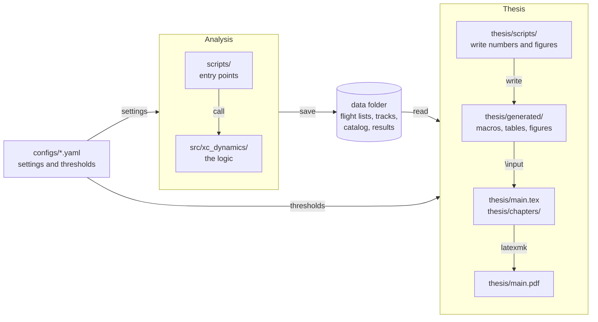

# Architecture

The repository has two halves. The **analysis** turns the FFVL archive into data and
results saved on disk. The **thesis** reads what was saved and turns it into the numbers,
tables and figures of the PDF. Data flows one way, from the analysis to the thesis.



## The parts

### `src/xc_dynamics/`: the logic

All the code that does the work, one subpackage per area (see [Areas](#areas)):
`download/` fetches the FFVL archive, `preprocessing/` reads the IGC tracks and tests
them, `common/` holds what every script uses, such as the record of a run. A function takes
every setting as an argument: it never reads `configs/`, and never imports `scripts/`
or `thesis/`. So each function can be tested on its own (`tests/` mirrors this folder)
and is documented from its docstring in the [Reference](reference/download.md).

### `scripts/`: the entry points

One script per task, run from the command line, in the folder of its area. A script
reads its settings in `configs/`, calls the functions of `src/` and saves what they
return in the data folder. It only orchestrates: command-line options, the loop over
flights or seasons, progress and errors. Every script that writes to the data folder is
listed in [Data folder](data.md), with the files it writes and who reads them; each
script's docstring says what it is for and how to run it.

### `configs/`: the settings

- `download.yaml`: data folders, seasons, parallel downloads. They depend on the machine.
- `preprocessing.yaml`: the thresholds of the pre-processing. They are part of the
  method, so the thesis quotes them.

### `thesis/`: the manuscript

- `main.tex`, `preamble.tex`, `chapters/`: the LaTeX source. The text never types a
  number that comes from the data or from a config: it writes a macro. Chapters are
  named after their subject (`chapters/dataset.tex`); their order, and so their
  numbers, is the list of `\input` in `main.tex`.
- `scripts/`: the scripts that write those macros and figures. `config.py` turns the
  thresholds into macros; each chapter that quotes data has its own script, named like
  the chapter (`dataset.py`, `preprocessing.py`). They read what the analysis saved and
  never run it: at most they count, take percentages and draw. The diagrams of a rule
  are the exception: they run the rule itself on synthetic tracks, so they need no data.
- `generated/`: what these scripts write, `.tex` files in `tex/` and figures in
  `figures/<chapter>/`, read by `main.tex` and the chapters. They are never edited by
  hand. They are committed, so the thesis compiles on a machine without the data folder.
- `build.sh`: runs the scripts, then compiles. See [Building the thesis](guides/thesis.md).

## Areas

The code is split by area, a function of the work: `download`, `preprocessing`, and
later the analyses. An area has the same name at every level:

```text
src/xc_dynamics/<area>/     the logic
tests/<area>/               its tests
scripts/<area>/             its entry points
configs/<area>.yaml         its settings, if it has any
docs/reference/<area>.md    its functions, from the docstrings
```

`common` is the area of what all the others use; it has no script and no config.

The thesis is split by chapter instead (`thesis/scripts/dataset.py`), since a chapter
can draw on several areas. Pages such as [Pre-processing](preprocessing.md) join the two:
each step of the pre-processing chapter leads to its function.

## Rules

- `src/` imports nothing from `scripts/` or `thesis/`. Both import `src/`; nothing
  imports them.
- The analysis never reads `thesis/`.
- A number in the thesis has one source, a config key or a saved result, and reaches
  the text through a macro.
