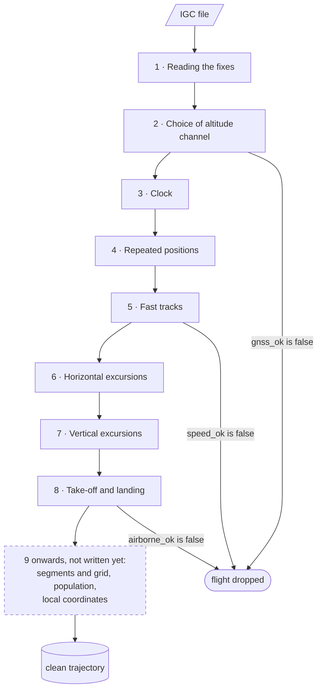

# Pre-processing

The pre-processing turns each IGC file into segments of clean fixes, each with a time, a
position and an altitude. The thesis describes it in the chapter Trajectory
pre-processing, one section per step, in the order they run; this page leads from each
step to its code, its thresholds and the results it is chosen on.

## Steps

| Step | What it does | Function | Thresholds |
|---|---|---|---|
| 1 · Reading the fixes | each `B` record becomes a fix with time, position and both altitudes; unreadable records are skipped | [`read_igc`][xc_dynamics.preprocessing.igc.read_igc] | none |
| 2 · Choice of altitude channel | drops the flight if its GNSS altitude is too often missing or too flat; marks the barometer as a witness; deletes the fixes without a GNSS altitude | [`altitude_channel`][xc_dynamics.preprocessing.altitude.altitude_channel], then [`known_altitude`][xc_dynamics.preprocessing.altitude.known_altitude] | `altitude.*` |
| 3 · Clock | deletes the fixes that do not come after every fix before them | [`increasing_time`][xc_dynamics.preprocessing.clean.increasing_time] | none |
| 4 · Repeated positions | deletes the fixes at the position of the fix before | [`moving_position`][xc_dynamics.preprocessing.clean.moving_position] | none |
| 5 · Fast tracks | drops the flight if its median step speed is too high | [`track_speed`][xc_dynamics.preprocessing.speed.track_speed], on [`step_speed`][xc_dynamics.preprocessing.speed.step_speed] | `speed.median_max_kmh` |
| 6 · Horizontal excursions | deletes the fixes the glider could not reach, when the track comes back within W; otherwise splits the flight | [`horizontal_excursions`][xc_dynamics.preprocessing.excursion.horizontal_excursions] | `speed.max_kmh`, `excursion.window_s` |
| 7 · Vertical excursions | the same on the GNSS altitude, inside each segment | [`vertical_excursions`][xc_dynamics.preprocessing.excursion.vertical_excursions] | `vertical.max_ms`, `excursion.window_s` |
| 8 · Take-off and landing | deletes the fixes before the first and after the last stretch faster than `min_kmh` for `min_s`; drops the flight if there is none, or if it has no fast step for longer than `max_pause_s` in between; records `t_takeoff` and `t_landing` | [`airborne_span`][xc_dynamics.preprocessing.airborne.airborne_span], [`longest_pause`][xc_dynamics.preprocessing.airborne.longest_pause] | `airborne.*` |

The modules are in
[`src/xc_dynamics/preprocessing/`](https://github.com/matteodisante/xc-dynamics/tree/main/src/xc_dynamics/preprocessing),
their tests in `tests/preprocessing/`.

## How the code runs them

- **Two kinds of step.** A rule on fixes (`known_altitude`, steps 3, 4, 6, 7 and 8) returns
  a mask, `True` for the fixes to keep; the excursion rules also return a mask of the
  first fix of each new segment. A verdict on a flight (`altitude_channel`, step 5)
  returns the quantities it measured and a flag, `gnss_ok` or `speed_ok`, and deletes no
  fix. Step 8 is both: it deletes the fixes on the ground and sets `airborne_ok`, False
  when no stretch is fast enough or the pause is too long.
- **Order.** Each rule runs on the fixes the previous ones left. Steps 5 to 7 divide by
  the time between fixes, so they need the strictly increasing times the clock rule
  leaves.
- **Pipelines**, in `flight.py`:
  [`before_horizontal`][xc_dynamics.preprocessing.flight.before_horizontal] runs steps 1
  to 5, [`before_vertical`][xc_dynamics.preprocessing.flight.before_vertical] steps 1 to
  6 and numbers the segments in a column `segment`,
  [`preprocess`][xc_dynamics.preprocessing.flight.preprocess] every step, numbering the
  segments again after the splits of step 7 and the cuts of step 8. A script that
  chooses a threshold runs the steps before its rule, so it sees the fixes the rule will
  receive.
- **Sampling interval.** `before_horizontal` also records the sampling interval of the
  track as read ([`sampling_interval`][xc_dynamics.preprocessing.sampling.sampling_interval]),
  shown in the dataset chapter; no step uses it.

## Thresholds

Every threshold is a key of `configs/preprocessing.yaml`, passed to the functions as an
argument, and quoted by the thesis as a macro ([Building the thesis](guides/thesis.md)).
The speed thresholds are set per discipline, `para` and `hang`. The scripts are in
`scripts/preprocessing/`; `thesis/scripts/preprocessing.py` draws their results. Why each
value: the thesis section of its step.

| Key | Step | Chosen on | Script → thesis |
|---|---|---|---|
| `altitude.*` | 2 | set by hand | |
| `speed.median_max_kmh` | 5 | the median step speed of every flight | `flight_speeds.py` → figures median-speed |
| `speed.max_kmh` | 6 | the ground speed over windows of W ([`window_speed`][xc_dynamics.preprocessing.speed.window_speed]), by wing class | `speed_histograms.py` → figure top-speed |
| `excursion.window_s`, W | 6, 7 | set by hand, checked with half and twice W (`window_short_s`, `window_long_s`, used by no step) | `excursion_counts.py` → excursion table |
| `vertical.max_ms` | 7 | the vertical speed of the barometer over windows of W, in the flights whose barometer is a witness ([`vertical_speeds`][xc_dynamics.preprocessing.altitude.vertical_speeds], [`vertical_window_speeds`][xc_dynamics.preprocessing.altitude.vertical_window_speeds]) | `vertical_histograms.py` → figure vertical-speed; checked by `vertical_counts.py` → vertical table |
| `airborne.min_kmh`, `airborne.min_s`, `airborne.max_pause_s` | 8 | set by hand | `airborne_counts.py` |

## Adding a step

1. Write the function in `src/xc_dynamics/preprocessing/` and its test in
   `tests/preprocessing/`, with the thresholds as arguments.
2. Add the keys, if any, to `configs/preprocessing.yaml`.
3. Add the module to [Reference](reference/preprocessing.md) if it is new.
4. Add the step to the scheme and to the tables of this page.
5. If a script saves a result for the step, add its files to [Data folder](data.md).
