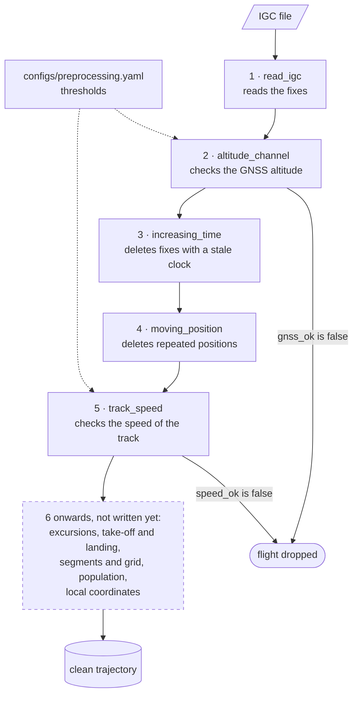

# Pre-processing: steps and modules

The pre-processing turns each IGC file into a trajectory fit for analysis. The thesis
describes it step by step, in the pre-processing chapter, one section per step. The
code does not number the steps: this page is the one place that joins the two, and its
step numbers only give the order in which the steps run. Find the section in the
thesis, read across the row, and you have the function, the thresholds and the test.

## Scheme

Steps 3 and 4 delete single fixes; steps 2 and 5 judge the whole flight and can drop it.

## Map

The steps run in the order of the table. The modules are in
[`src/xc_dynamics/preprocessing/`](https://github.com/matteodisante/xc-dynamics/tree/main/src/xc_dynamics/preprocessing),
the tests in `tests/preprocessing/`, the thresholds in `configs/preprocessing.yaml`.

| Step | Thesis section | Function | Thresholds | Returns |
|---|---|---|---|---|
| 1 | Reading the fixes | [`read_igc`][xc_dynamics.preprocessing.igc.read_igc] | none | the fixes, one row each |
| 2 | Choice of altitude channel | [`altitude_channel`][xc_dynamics.preprocessing.altitude.altitude_channel] | `altitude.*` | a verdict on the flight |
| 3 | Clock | [`increasing_time`][xc_dynamics.preprocessing.clean.increasing_time] | none | a mask of the fixes to keep |
| 4 | Repeated positions | [`moving_position`][xc_dynamics.preprocessing.clean.moving_position] | none | a mask of the fixes to keep |
| 5 | Fast tracks | [`track_speed`][xc_dynamics.preprocessing.speed.track_speed], on the speeds of [`step_speed`][xc_dynamics.preprocessing.speed.step_speed] | `speed.median_max_kmh` | a verdict on the flight |

## Two kinds of step

- **Rules on fixes** (steps 3 and 4, in `clean.py`) return a boolean mask, `True` for the
  fixes to keep. Each runs on the fixes the previous ones left, so the caller filters
  between one rule and the next.
- **Verdicts on a flight** (steps 2 and 5) return a dictionary with the measured
  quantities and a flag, `gnss_ok` or `speed_ok`, that says whether the flight stays.
  They never delete a fix.

Step 5 divides by the time between fixes, so it needs the times the clock rule leaves:
strictly increasing.

## Thresholds

Every threshold is a key of `configs/preprocessing.yaml`; a function receives it as an
argument and never reads the file. The thesis quotes the same keys as macros (see
[Building the thesis](guides/thesis.md)).

The two speed thresholds are set per discipline, `para` and `hang`, and judge different
things:

- `speed.median_max_kmh` (step 5) judges a whole flight by the median speed of its steps.
  It was read off the histograms of the median speed of every flight, drawn by
  `thesis/scripts/preprocessing.py` from the output of
  `scripts/preprocessing/flight_speeds.py`.
- `speed.max_kmh` judges a single step: a faster one is a recorder error. The horizontal
  excursion rule, not written yet, will use it. It is read off the histograms of speed
  and straightness of the steps ([`step_straightness`][xc_dynamics.preprocessing.speed.step_straightness]),
  counted by `scripts/preprocessing/step_straightness.py`: real flight goes nearly
  straight, a recorder error goes out and comes back, and the top speed is where the
  straight steps end. Only steps of at most `straightness.dt_max_s` are counted, since
  over a longer step a turn in a thermal looks like an out-and-back.

## Adding a step

1. Write the function in `src/xc_dynamics/preprocessing/` and its test in
   `tests/preprocessing/`, with the thresholds as arguments.
2. Add the keys, if any, to `configs/preprocessing.yaml`.
3. Add the module to [Reference](reference/preprocessing.md) if it is new.
4. Add a node to the scheme and a row to the table above.
5. If a script saves a result for the step, add its files to [Data folder](data.md).
