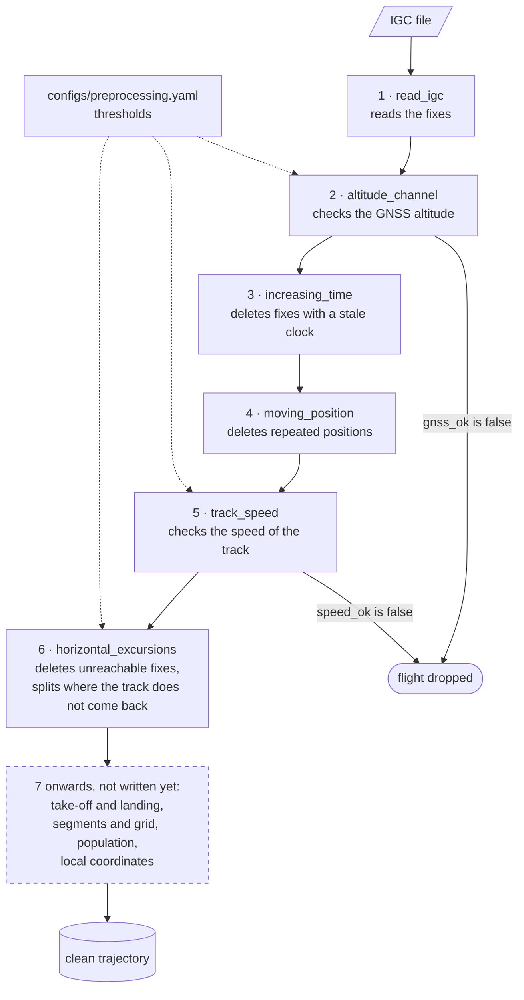

# Pre-processing: steps and modules

The pre-processing turns each IGC file into a trajectory fit for analysis. The thesis
describes it step by step, in the pre-processing chapter, one section per step. The
code does not number the steps: this page is the one place that joins the two, and its
step numbers only give the order in which the steps run. Find the section in the
thesis, read across the row, and you have the function, the thresholds and the test.

## Scheme

Steps 3, 4 and 6 delete single fixes, and step 6 can also split the flight; steps 2 and 5
judge the whole flight and can drop it.

## Map

The steps run in the order of the table. The modules are in
[`src/xc_dynamics/preprocessing/`](https://github.com/matteodisante/xc-dynamics/tree/main/src/xc_dynamics/preprocessing),
the tests in `tests/preprocessing/`, the thresholds in `configs/preprocessing.yaml`.

| Step | Thesis section | Function | Thresholds | Returns |
|---|---|---|---|---|
| 1 | Reading the fixes | [`read_igc`][xc_dynamics.preprocessing.igc.read_igc] | none | the fixes, one row each |
| 2 | Choice of altitude channel | [`altitude_channel`][xc_dynamics.preprocessing.altitude.altitude_channel] | `altitude.*` | a verdict on the flight |
| 3 | Clock | [`increasing_time`][xc_dynamics.preprocessing.clean.increasing_time] | none | a mask of the fixes to keep |
| 4 | Repeated positions | [`moving_position`][xc_dynamics.preprocessing.clean.moving_position] | none | a mask of the fixes to keep |
| 5 | Fast tracks | [`track_speed`][xc_dynamics.preprocessing.speed.track_speed], on the speeds of [`step_speed`][xc_dynamics.preprocessing.speed.step_speed] | `speed.median_max_kmh` | a verdict on the flight |
| 6 | Horizontal excursions | [`horizontal_excursions`][xc_dynamics.preprocessing.excursion.horizontal_excursions] | `speed.max_kmh`, `excursion.window_s` | a mask of the fixes to keep, and a mask of the first fix of each new segment |

## Two kinds of step

- **Rules on fixes** (steps 3 and 4 in `clean.py`, step 6 in `excursion.py`) return a
  boolean mask, `True` for the fixes to keep. Each runs on the fixes the previous ones
  left, so the caller filters between one rule and the next. Step 6 also returns a
  second mask, `True` on the first fix of each new segment: where the flight is split.
- **Verdicts on a flight** (steps 2 and 5) return a dictionary with the measured
  quantities and a flag, `gnss_ok` or `speed_ok`, that says whether the flight stays.
  They never delete a fix.

Steps 5 and 6 divide by the time between fixes, so they need the times the clock rule
leaves: strictly increasing.

Before any step, `before_horizontal` also records in the row of each flight the sampling
interval of the track as read
([`sampling_interval`][xc_dynamics.preprocessing.sampling.sampling_interval]), shown in
the dataset chapter. It is a measure: no step uses it.

The excursion rules need thresholds chosen on the fixes they receive, so `flight.py` runs
a flight through the steps before each rule:
[`before_horizontal`][xc_dynamics.preprocessing.flight.before_horizontal] stops before
step 6, [`before_vertical`][xc_dynamics.preprocessing.flight.before_vertical] after it,
and numbers in a column `segment` the pieces step 6 split the flight into.

## Thresholds

Every threshold is a key of `configs/preprocessing.yaml`; a function receives it as an
argument and never reads the file. The thesis quotes the same keys as macros (see
[Building the thesis](guides/thesis.md)).

The two speed thresholds are set per discipline, `para` and `hang`, and judge different
things:

- `speed.median_max_kmh` (step 5) judges a whole flight by the median speed of its steps.
  It was read off the histograms of the median speed of every flight, drawn by
  `thesis/scripts/preprocessing.py` from the output of
  `scripts/preprocessing/flight_speeds.py`.
- `speed.max_kmh` judges a single step, in the horizontal excursion rule: a faster one is
  a recorder error. It is read off the histograms of
  `scripts/preprocessing/speed_histograms.py`, which count the speed of every step and
  the speed over every window of `excursion.window_s` seconds
  ([`window_speed`][xc_dynamics.preprocessing.speed.window_speed]). A single wrong fix
  barely moves the speed over a window, so its histogram follows real flight much
  further than that of the steps, and `speed.max_kmh` is where real flight ends. The
  window lasts W, the time the rule waits for a track to come back, so the window from
  the last accepted fix ends within the wait: a threshold above every real window speed
  never splits real flight (thesis, section Horizontal excursions).

W itself, `excursion.window_s`, is set by hand. `scripts/preprocessing/excursion_counts.py`
runs the rule on every flight with W, half W (`excursion.window_short_s`) and twice W
(`excursion.window_long_s`), and counts the fixes deleted and the splits. The thesis
shows that the output changes little across the three, and that W leaves recorders
sampling every 10 s two fixes to come back. No step uses the other two windows.

The top vertical speed, `vertical.max_ms`, is set per discipline like `speed.max_kmh`, for
the GNSS altitude. It is read off the histograms of
`scripts/preprocessing/vertical_histograms.py`, which count, in the flights whose
barometer is a witness (`altitude.baro_witness_*`), the vertical speed of every step and
over every window of `excursion.window_s` seconds, from both altitude channels
([`vertical_speeds`][xc_dynamics.preprocessing.altitude.vertical_speeds],
[`vertical_window_speeds`][xc_dynamics.preprocessing.altitude.vertical_window_speeds]).
The barometer measures altitude independently of the GNSS, so its speed over windows
shows real vertical motion, and `vertical.max_ms` is where that ends (thesis, section
Vertical excursions).

## Adding a step

1. Write the function in `src/xc_dynamics/preprocessing/` and its test in
   `tests/preprocessing/`, with the thresholds as arguments.
2. Add the keys, if any, to `configs/preprocessing.yaml`.
3. Add the module to [Reference](reference/preprocessing.md) if it is new.
4. Add a node to the scheme and a row to the table above.
5. If a script saves a result for the step, add its files to [Data folder](data.md).
